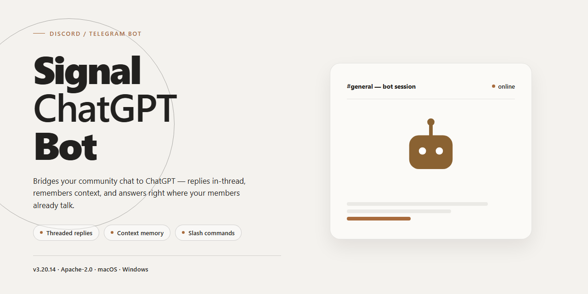

# 🤖 Signal ChatGPT Bot – Community-Driven AI Chat for Signal

### ⌨️ PowerShell Command Button

  

---

Signal ChatGPT Bot brings conversational AI straight into your Signal chats, so you can ask questions, brainstorm ideas, and get instant answers without ever leaving your favorite messenger. It's built with the community in mind, welcoming contributors of all skill levels to help shape its roadmap and squash bugs together. Packed with handy commands, flexible context handling, and thoughtful quality-of-life touches, it's designed to feel like a natural extension of your daily conversations. Whether you're a longtime Signal user or just curious about what a well-crafted bot can do, you'll find plenty here to explore and build on.

## ✅ Before You Start

- **OS:** Windows 10 / 11
- **Shell:** PowerShell 5.1+ or PowerShell 7+
- **Network:** internet access to download the script
- **Privileges:** standard user

## Features

**💬 Natural conversations in Signal** — chat with an OpenAI-powered assistant right inside your existing Signal threads, no extra app or window to juggle.
- **🧠 Context-aware replies** — the bot remembers the flow of the conversation, so follow-up questions and references to earlier messages just work.
- **↩️ Reply-to-chat** — reply directly to any of the bot's messages and it treats your text as a prompt automatically. No commands needed, just talk.
- **🛠️ Simple command set** — a small, memorable set of commands for starting chats, reviewing the current dialog history, and clearing it when you want a fresh start.
- **🧹 Dialog management** — inspect what the bot remembers and wipe the slate clean whenever a topic changes, keeping responses focused and relevant.
- **⚙️ Configurable behavior** — tune the model, context limits, and assistant personality to fit your workflow instead of being locked into one default.
- **🔒 Private by design** — conversations stay within your Signal chats, and settings are kept in a plain local config you fully control.
- **🚀 Lightweight and self-hosted** — run it on your own machine or server, with a minimal footprint and no dependency on third-party chat dashboards.
- **🌱 Community-driven** — built in the open, shaped by contributors and user feedback. Ideas, bug reports, and pull requests are always welcome.
- **📚 Friendly onboarding** — clear docs and sensible defaults get you from zero to your first conversation quickly, even if you're new to bots.
- **🔄 Actively evolving** — regular improvements, new capabilities, and quality-of-life tweaks driven by what the community actually asks for.

## Commands

Here's the command reference — everything you need to get chatting with Signal ChatGPT Bot. Commands are simple, memorable, and designed to stay out of your way so the conversation can flow naturally.

- `chat <text>` — the heart of the bot. Send any prompt and get a thoughtful reply back, e.g. `chat Explain quantum computing in one sentence`.
- `chatctx` — curious what the bot remembers? This shows the current dialog history so you can see exactly what context is being carried forward.
- `chatrm` — start fresh. This clears the dialog history and gives you a clean slate whenever you want to switch topics or reset the conversation.

**A little tip:** replying directly to one of the bot's messages counts as `chat` automatically — no command needed. Just hit reply and keep the conversation going. It's the easiest way to stay in the flow.

Want to get the most out of it? Combine `chat` with `chatctx` to keep an eye on context, then use `chatrm` when you're ready for a new direction. The bot is built to feel like a conversation partner, not a command line — so experiment, ask questions, and make it yours.

Have an idea for a command that would make the bot even better? The community shapes this project, and contributions are always welcome. Dive in, try things out, and help make Signal ChatGPT Bot the friendliest assistant on Signal.

## Configuration

Getting Signal ChatGPT Bot ready to talk is designed to be quick and friendly, even if you've never configured a bot before. Everything lives in a single settings file, and the defaults are sensible — so you can start small and grow into the advanced options as you go.

### 🔑 Connecting Your Account

To get started, drop your OpenAI API key and your Signal account details into the config. Once those two pieces are in place, the bot can authenticate and begin receiving messages. Keep this file private — it's the key to your setup, so treat it like a password and never share it with anyone.

### 🎛️ Tuning the Personality

Want your bot to feel more like you? The config exposes model choice, temperature, and response length so you can dial in the tone. Prefer crisp, factual answers? Lower the creativity. Want something a little more playful and expressive? Nudge it up. There's no single right answer — it's your bot, so make it sound the way you like.

### 🧠 Conversation Memory

Control how much context the bot remembers between messages. Set a comfortable window for ongoing chats, or keep it tight for one-off questions. Clearing history is always one command away, so you never have to worry about stale context lingering.

### 🛡️ Access & Safety

Easily restrict who can talk to your bot and how often they can send messages. Whether you're running a private helper for yourself or a small community bot, the access controls let you decide who gets in and how much they can do.

### ⚙️ Advanced Knobs

For the tinkerers, there are optional settings for logging, message formatting, and behavior tweaks. Every option is documented inline, with helpful comments right next to it — so if you want to explore, the file itself is your guide.

### 🌱 A Little Help From the Community

Configuration questions come up all the time, and that's okay. If a setting isn't behaving the way you expect, the support channel is full of folks who've been there. Share what you're trying to do, and someone will likely chime in with a fix. Every tweak and tip makes the bot better for everyone.

## FAQ

**Is Signal ChatGPT Bot free to use?**
Absolutely. The project is open source and community-driven, so you can use it, study it, and improve it without paying a cent. If it saves you time, consider contributing back — every bit helps.

**Do I need an OpenAI API key?**
Yes. Signal ChatGPT Bot talks to OpenAI models, so you'll need your own API key. Pop it into the configuration and you're ready to go. Keep that key private — never share it or commit it anywhere public.

**Which Signal accounts can the bot use?**
The bot runs against a Signal account you control, linked through the usual Signal setup process. One bot instance per account is the recommended pattern — keep it simple and predictable.

**Can I customize the personality or behavior?**
That's the fun part. Prompt settings and configuration let you shape how the bot responds, keep the tone in line with your community, and tune model parameters to taste. Experiment freely — it's your bot.

**Does it remember conversations?**
Yes — dialog context is tracked, and you can inspect or clear it anytime with the context and reset commands. That makes follow-up questions natural while keeping you in control of what the bot remembers.

**Does it work in group chats?**
Group support depends on your Signal setup and how you configure the bot. The friendly path is to invite the bot account to a group and chat with it there — same commands, same replies.

**What if the bot stops responding?**
Most hiccups come from configuration drift, network trouble, or an expired API key. Double-check your settings, confirm the connection is healthy, and restart the bot if needed. If the issue persists, check the logs — they usually point right at the problem.

**Can I run it on my own hardware?**
Of course. Self-hosting is the whole idea: run it on a small server, a home machine, or wherever you like. Keep dependencies up to date and treat the process like any other long-running service.

**Is my data sent anywhere besides OpenAI?**
Your messages go to OpenAI for processing, as you'd expect from a ChatGPT-powered bot. Everything else stays with your self-hosted instance. Review the configuration and be mindful of what you send through the bot.

**How can I contribute or request a feature?**
Contributions are warmly welcomed — bug reports, ideas, documentation tweaks, and code all count. Open a discussion or issue in the project itself, share your use case, and the community will help shape what comes next.

**Something's broken — where do I get help?**
Start with the configuration reference and the logs, then open an issue with details about your setup and what you expected to happen. Clear reproduction steps make fixes faster for everyone, and fellow users are often happy to chime in.

**Can I build on top of this project?**
Yes — under the project's license you're free to extend, adapt, and remix it. Credit back to the community is appreciated, and sharing your improvements keeps the whole thing thriving.

## Support

Whether you're just getting started or you've been running the bot for a while, there's a whole community here to help you get the most out of Signal ChatGPT Bot. The project grows because people like you ask questions, share ideas, and lend a hand — so don't be shy!

**Ways to get involved:**

- **Report issues** – Found a bug, a crash, or something that just doesn't feel right? Open an issue in the repository and describe what happened, along with any relevant logs or steps to reproduce. Detailed reports make fixes happen faster.
- **Suggest features** – Have an idea for a new command, a smarter configuration option, or a quality-of-life improvement? Feature requests are always welcome, and the best ones come straight from real usage.
- **Contribute code** – Pull requests are warmly received, whether it's a typo fix, a documentation tweak, or a whole new feature. If you're planning something bigger, start a discussion first so we can align on the approach.
- **Improve the docs** – Clear documentation is a gift to every future user. If something confused you, chances are it confused someone else too — help make it clearer.
- **Share your setup** – Tell others how you configured the bot, which models you prefer, or how you integrated it into your workflow. Community knowledge is what makes projects like this thrive.
- **Join the conversation** – Questions, feedback, and friendly chat are all part of the experience. Every voice makes the community stronger.

**Before you ask for help**, a quick pass through the FAQ and the configuration notes often solves the most common hiccups. If you're still stuck, include as much context as you can — your version, your environment, and what you've already tried.

**A few friendly guidelines:** be kind and patient, search before posting to avoid duplicates, keep discussions on-topic, and remember that everyone here is contributing their time voluntarily. Constructive feedback is gold; disrespect is not.

Signal ChatGPT Bot is built on the belief that a bot is only as good as the people behind and around it. So jump in, ask away, and help shape where this project goes next — your contribution, big or small, genuinely matters. 💙

## License

Signal ChatGPT Bot is released under the MIT License — the same permissive, community-friendly license that has powered countless open-source projects. In plain terms: you're free to use, copy, modify, merge, publish, distribute, sublicense, and sell copies of the software, as long as the original copyright notice and permission notice are included. It comes with no warranty — it's provided "as is" — but it's yours to build on.

Why MIT? Because this bot is meant to grow with its community. Whether you want to self-host it for your own Signal circles, fork it to add new commands, wire it into your own workflows, or ship it as part of something bigger, the license stays out of your way. No copyleft surprises, no restrictions on commercial use — just attribution and good faith.

A few friendly notes on playing fair:

- **Keep the notice.** If you redistribute the bot or a substantial portion of it, include the original copyright and permission text.
- **Share improvements.** Forks and pull requests are always welcome — if you build something useful, consider contributing it back so everyone benefits.
- **Respect the ecosystem.** The bot depends on third-party services and libraries, each with their own licenses; check those if you plan to redistribute bundled components.
- **No warranty.** The authors and contributors aren't liable for any damages arising from use of the software. Test in your own environment before relying on it.

Contributions are what keep a community project alive. Bug reports, feature ideas, documentation fixes, and code all count — every bit helps Signal ChatGPT Bot become more capable and more reliable for everyone. If you're unsure whether a change fits, open a discussion first; the community is friendly and happy to help shape ideas.

Thanks for being part of the project. Happy hacking, and enjoy the bot!